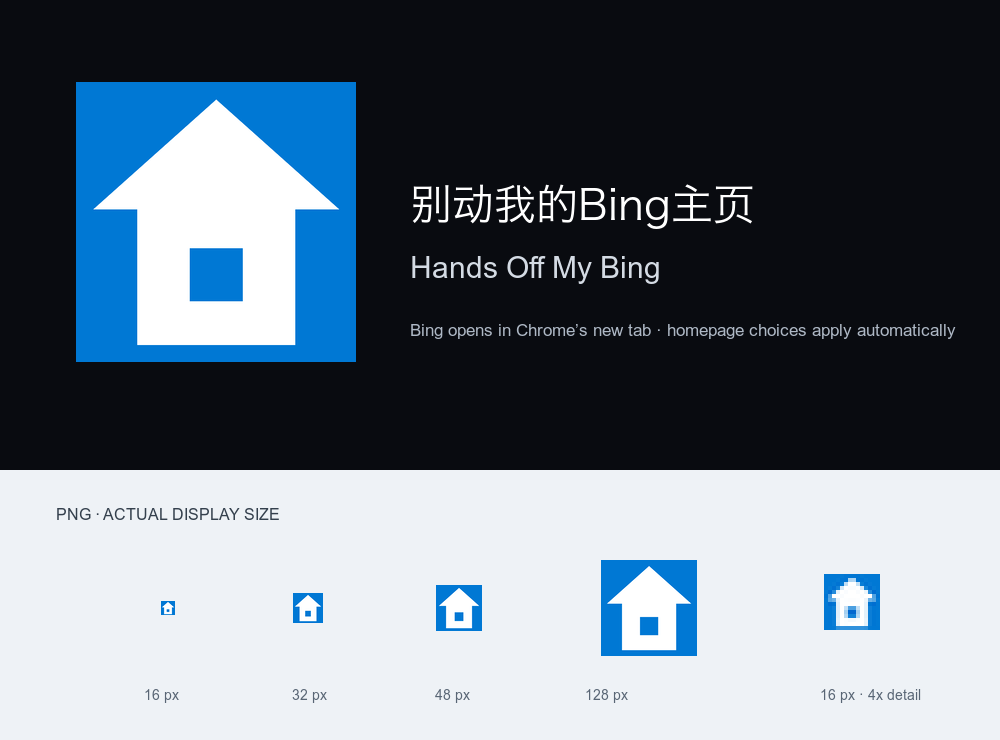

# 别动我的Bing主页 · Hands Off My Bing

[简体中文](#简体中文) · [English](#english) · [Deutsch](#deutsch)



## 简体中文

**别动我的Bing主页** 是一款独立的 Chrome 扩展。它会替换 Chrome 新标签页，并打开 Bing 首页；随后在受支持的 Bing 首页上自动应用你选择的显示偏好。

### 功能

- **四项独立设置：** 菜单栏、新闻和关注、必应热点、背景图片。每项可选“保持原样 / 关闭 / 显示”。默认均为“保持原样”，不会改动对应的 Bing 设置。
- **总开关：** 暂停或恢复自动应用。暂停只停止主页偏好处理，不会恢复 Chrome 默认新标签页；停用或卸载扩展后，Chrome 默认新标签页才会恢复。暂停或卸载也不会撤销已由 Bing 保存的原生设置。
- **快捷预设：** “只留壁纸”会关闭其余三项并显示背景图片；“全部关闭”会关闭四项。应用预设会启用自动应用。
- **切换间隔：** 相邻设置切换之间等待 0–2000 毫秒，默认 80 毫秒。输入整数；0 表示不额外等待。过短的间隔可能导致某次切换未生效。
- **界面语言：** 可跟随浏览器语言或选择简体中文、English、Deutsch。

### 适用范围与限制

- 扩展只在 https://www.bing.com/、https://cn.bing.com/ 和 https://bing.com/ 的 HTTPS 首页根路径应用偏好，不处理搜索结果或其他路径。
- 只有在自动应用已启用且“新闻和关注”设为“关闭”时，扩展才会对通过扩展新标签页打开、由扩展管理的 www.bing.com 标签分别尝试阻止一个指定轮播接口的后台请求。它不是通用广告拦截器，也不阻止所有新闻内容下载。主页显示由 Bing 原生开关和可移除样式配合实现；隐藏不代表阻止下载。
- 自动操作时，扩展会尽量避免抢走地址栏焦点。临时焦点保护最长 20 秒，不读取你输入的文字，也不能保证所有快速输入时序都不会漏字。

### 隐私

四项偏好、自动应用开关、切换间隔和界面语言保存在本机；受管标签编号只在当前浏览器会话中保留。扩展会短暂检查自己打开的标签页 URL 和状态，只用站点与路径识别受支持的首页，不提取查询参数或搜索词，也不保存浏览历史。它不读取搜索文字、页面正文、Cookie、账号资料或请求正文，不向开发者或分析服务器发送数据。Bing 仍会正常联网，并自行处理其原生设置。

更多信息：[English privacy policy](https://smallwest888.github.io/hands-off-my-bing/privacy/privacy.html) · [简体中文隐私说明](https://smallwest888.github.io/hands-off-my-bing/privacy/privacy.zh-CN.html) · [Datenschutzhinweise auf Deutsch](https://smallwest888.github.io/hands-off-my-bing/privacy/privacy.de.html)。

### 安装、构建和检查

Chrome 111 或更新版本：

1. 克隆或下载此仓库。
2. 在 Chrome 扩展管理页开启开发者模式。
3. 选择“加载已解压的扩展程序”，并选择仓库中的 src/ 文件夹。
4. 查看 Chrome 显示的站点访问说明。

要运行全部七套离线检查，需要当前受支持的 Node.js LTS、zip 和 unzip：

```sh
node scripts/package-current.mjs --check
```

使用 --freeze 可在本机生成扩展目录和发布归档；生成物不会作为运行源码提交。唯一运行源码位于 src/。

### 项目状态

仓库包含 1.2.11 源码快照。该版本尚未完成真实 Chrome 运行验收，也未提交到 Chrome Web Store。本项目独立开发，与 Microsoft、Bing 或 Google 无隶属关系，也未获其背书。仓库地址：[GitHub](https://github.com/smallwest888/hands-off-my-bing)。

### 许可证

本项目仅依据 GNU General Public License 第 3 版发布。SPDX 标识符：GPL-3.0-only。完整许可证文本见 [LICENSE](LICENSE)。

## English

**Hands Off My Bing** is an independent Chrome extension. It replaces Chrome’s new-tab page, opens the Bing homepage, and then automatically applies your display choices on supported Bing homepages.

### Features

- **Four independent choices:** menu bar, news and interests, Bing trends, and background image. Each can be set to **Keep current**, **Turn off**, or **Show**. All four default to **Keep current**, which leaves the corresponding Bing setting unchanged.
- **Main switch:** pause or resume automatic application. Pausing stops homepage preference handling but does not restore Chrome’s default new-tab page. Chrome’s default page returns when the extension is disabled or uninstalled. Pausing or uninstalling also does not undo native settings already saved by Bing.
- **Quick presets:** **Wallpaper only** turns off the other three items and shows the background image; **Turn all off** turns off all four. Choosing a preset enables automatic application.
- **Switch interval:** wait 0–2000 milliseconds between successive setting changes; the default is 80 ms. Enter a whole number. A value of 0 adds no wait. An interval that is too short may cause a change to be missed.
- **Interface language:** follow the browser language or choose Simplified Chinese, English, or German.

### Scope and limitations

- Preferences apply only to the HTTPS homepage root of www.bing.com, cn.bing.com, and bing.com. Search-result pages and other paths are not handled.
- Only when automatic application is enabled and **News and interests** is set to **Turn off** does the extension attempt to block background requests to one specific carousel endpoint in each extension-opened, extension-managed www.bing.com tab. This is not a general ad blocker and does not block every news download. Homepage display changes combine Bing’s native controls with removable styles; hiding does not mean downloads are blocked.
- During automatic actions, the extension makes a best effort to avoid taking focus from the address bar. Temporary focus protection lasts at most 20 seconds, does not read typed text, and cannot guarantee that every rapid input sequence avoids missed characters.

### Privacy

The four choices, automatic-apply switch, interval, and interface language are stored locally. Managed tab IDs are kept only for the current browser session. The extension briefly checks the URL and state of tabs it opens; it uses only the site and path to recognize a supported homepage, does not extract query values or search terms, and does not save browsing history. It does not read search text, page content, cookies, account details, or request bodies, and sends no data to a developer or analytics server. Bing continues to connect normally and manages its native settings.

More information: [English privacy policy](https://smallwest888.github.io/hands-off-my-bing/privacy/privacy.html) · [简体中文隐私说明](https://smallwest888.github.io/hands-off-my-bing/privacy/privacy.zh-CN.html) · [Datenschutzhinweise auf Deutsch](https://smallwest888.github.io/hands-off-my-bing/privacy/privacy.de.html).

### Install, build, and check

Chrome 111 or later:

1. Clone or download this repository.
2. Enable Developer mode on Chrome’s Extensions page.
3. Choose **Load unpacked** and select the repository’s src/ folder.
4. Review the site-access notice shown by Chrome.

To run all seven offline checks, you need a currently supported Node.js LTS release and the zip and unzip commands:

```sh
node scripts/package-current.mjs --check
```

The --freeze option can generate a local extension directory and release archives. Generated artifacts are not the runtime source and are not committed. The only runtime source is in src/.

### Project status

This repository contains the 1.2.11 source snapshot. Real Chrome runtime acceptance is still pending, and the extension has not been submitted to the Chrome Web Store. This is an independent project, not affiliated with or endorsed by Microsoft, Bing, or Google. Repository: [GitHub](https://github.com/smallwest888/hands-off-my-bing).

### License

This project is licensed **only** under version 3 of the GNU General Public License. SPDX identifier: GPL-3.0-only. See [LICENSE](LICENSE) for the full license text.

## Deutsch

**Hands Off My Bing** ist eine unabhängige Chrome-Erweiterung. Sie ersetzt Chromes Seite für neue Tabs, öffnet die Bing-Startseite und wendet dort auf unterstützten Bing-Startseiten automatisch deine Anzeigeoptionen an.

### Funktionen

- **Vier getrennte Einstellungen:** Menüleiste, Nachrichten und Interessen, Bing-Trends und Hintergrundbild. Für jede Option kannst du **Unverändert**, **Ausblenden** oder **Anzeigen** wählen. Standardmäßig stehen alle vier auf **Unverändert**; die entsprechende Bing-Einstellung bleibt dann bestehen.
- **Hauptschalter:** automatische Anwendung pausieren oder fortsetzen. Beim Pausieren wird nur die Verarbeitung der Startseitenoptionen angehalten; Chromes Standardseite für neue Tabs wird dadurch nicht wiederhergestellt. Sie erscheint wieder, wenn die Erweiterung deaktiviert oder entfernt wird. Pausieren oder Entfernen macht auch keine bereits von Bing gespeicherten Einstellungen rückgängig.
- **Schnelleinstellungen:** **Nur Hintergrundbild** blendet die anderen drei Elemente aus und zeigt das Hintergrundbild; **Alles ausblenden** blendet alle vier aus. Eine Schnelleinstellung aktiviert die automatische Anwendung.
- **Umschaltabstand:** Zwischen aufeinanderfolgenden Einstellungsänderungen wartet die Erweiterung 0–2000 Millisekunden; Standard sind 80 ms. Gib eine ganze Zahl ein. Bei 0 wird nicht zusätzlich gewartet. Ein zu kurzer Abstand kann dazu führen, dass eine Änderung ausbleibt.
- **Anzeigesprache:** Browsersprache übernehmen oder vereinfachtes Chinesisch, Englisch oder Deutsch auswählen.

### Geltungsbereich und Grenzen

- Die Einstellungen gelten nur auf den HTTPS-Startseiten unter www.bing.com, cn.bing.com und bing.com. Suchergebnisse und andere Pfade werden nicht bearbeitet.
- Nur wenn die automatische Anwendung aktiviert und **Nachrichten und Interessen** auf **Ausblenden** gestellt ist, versucht die Erweiterung, Hintergrundanfragen an einen bestimmten Carousel-Endpunkt in jedem von ihr geöffneten und verwalteten www.bing.com-Tab zu blockieren. Sie ist kein allgemeiner Werbeblocker und verhindert nicht alle Nachrichtendownloads. Änderungen der Startseitenanzeige kombinieren Bing-eigene Schalter mit entfernbaren Stilen; Ausblenden bedeutet nicht, dass Downloads blockiert werden.
- Bei automatischen Aktionen versucht die Erweiterung, den Fokus nicht von der Adressleiste abzuziehen. Der temporäre Fokus-Schutz dauert höchstens 20 Sekunden, liest keine eingegebenen Texte und kann nicht garantieren, dass bei jeder sehr schnellen Eingabefolge kein Zeichen verloren geht.

### Datenschutz

Die vier Optionen, der Schalter für die automatische Anwendung, der Umschaltabstand und die Anzeigesprache werden lokal gespeichert. Kennungen verwalteter Tabs bleiben nur in der aktuellen Browsersitzung erhalten. Die Erweiterung prüft kurz URL und Status der Tabs, die sie selbst öffnet. Zur Erkennung einer unterstützten Startseite verwendet sie nur Website und Pfad; Query-Werte und Suchbegriffe liest sie nicht aus und URLs speichert sie nicht als Verlauf. Sie liest keine Suchtexte, Seiteninhalte, Cookies, Kontodaten oder Anfrageinhalte und sendet keine Daten an Entwickler- oder Analyseserver. Bing verbindet sich weiterhin normal und verwaltet seine eigenen Einstellungen.

Weitere Informationen: [Datenschutzhinweise auf Deutsch](https://smallwest888.github.io/hands-off-my-bing/privacy/privacy.de.html) · [English privacy policy](https://smallwest888.github.io/hands-off-my-bing/privacy/privacy.html) · [简体中文隐私说明](https://smallwest888.github.io/hands-off-my-bing/privacy/privacy.zh-CN.html).

### Installation, Build und Prüfungen

Chrome 111 oder neuer:

1. Dieses Repository klonen oder herunterladen.
2. Auf Chromes Erweiterungsseite den Entwicklermodus aktivieren.
3. **Entpackte Erweiterung laden** wählen und den Ordner src/ im Repository auswählen.
4. Den von Chrome angezeigten Hinweis zum Websitezugriff prüfen.

Für alle sieben Offline-Prüfungen brauchst du eine aktuell unterstützte Node.js-LTS-Version sowie die Befehle zip und unzip:

```sh
node scripts/package-current.mjs --check
```

Die Option --freeze kann lokal ein Erweiterungsverzeichnis und Release-Archive erzeugen. Diese generierten Dateien sind nicht der Laufzeit-Quellcode und werden nicht eingecheckt. Der einzige Laufzeit-Quellcode liegt in src/.

### Projektstatus

Dieses Repository enthält den Quellcode-Snapshot 1.2.11. Die Prüfung im echten Chrome steht noch aus; die Erweiterung wurde nicht im Chrome Web Store eingereicht. Dies ist ein unabhängiges Projekt ohne Verbindung zu Microsoft, Bing oder Google und ohne deren Unterstützung. Repository: [GitHub](https://github.com/smallwest888/hands-off-my-bing).

### Lizenz

Dieses Projekt steht **ausschließlich** unter Version 3 der GNU General Public License. SPDX-Kennung: GPL-3.0-only. Der vollständige Lizenztext steht in [LICENSE](LICENSE).
